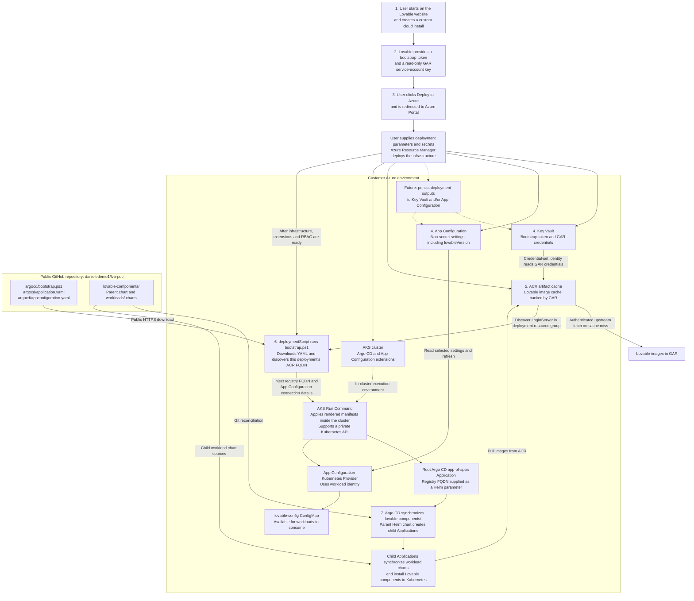

# Lovable custom cloud installation flow

This flow connects the Lovable onboarding experience, Azure infrastructure deployment, and GitOps-based installation into the customer's Kubernetes cluster.

**Terminology:** ACR is Azure Container Registry; GAR is Google Artifact Registry. The registry FQDN below is the ACR login server, not an Azure Arc endpoint.

## End-to-end flowchart

Solid arrows show deployment, reconciliation, or data dependencies. Dotted arrows show planned deployment-output persistence, not implemented behavior.

## How the pieces are glued together

1. **Lovable onboarding.** The user starts a custom cloud installation on the Lovable website. The website and credential-issuance experience are the intended entry point; they are outside this repository.
2. **Bootstrap credentials.** Lovable supplies the bootstrap token and a GAR service-account key with read-only access to the required images. The Azure form expects the key to be base64-encoded. These are deployment inputs, not files committed to Git.
3. **Azure handoff.** The **Deploy to Azure** action opens Azure Portal with the deployment experience defined by [deployment_ui.json](infra/deployment_ui.json) and the resources defined by [deployment.json](infra/deployment.json).
4. **Configuration and secrets.** The template stores `bootstrapToken`, `GAR-serviceKey`, and the GAR authentication username in Key Vault. It stores the non-secret `lovableVersion` setting in App Configuration. Deployment outputs are currently returned by ARM; persisting additional outputs in either store is a future enhancement. Sensitive outputs belong in Key Vault.
5. **Image distribution.** ACR's credential set reads the GAR credentials from Key Vault using its managed identity. The artifact-cache rule maps the configured GAR repository to `lovable/*` in ACR. Kubernetes requests images such as `<acr-fqdn>/lovable/cyber-hello:latest`; ACR fetches from GAR on a cache miss rather than eagerly mirroring every image.
6. **Cluster bootstrap.** After infrastructure, extensions, and role assignments are deployed, the deployment script downloads [bootstrap.ps1](argocd/bootstrap.ps1), the [root Application template](argocd/application.yaml), and the [App Configuration manifest](argocd/appconfiguration.yaml) from the public repository. Bootstrap discovers the sole ACR in the deployment resource group and reads its `LoginServer`, replacing `${REGISTRY_URL}` in the root manifest. It also injects the deployed App Configuration endpoint and identity details. AKS Run Command applies the rendered manifests from inside the cluster, so the script does not need direct access to a private Kubernetes API.
7. **Continuous GitOps reconciliation.** The root Application tracks `lovable-components/` on `main` in the public repository. Its [parent Helm chart](lovable-components/templates/applications.yaml) creates the child Applications listed in [values.yaml](lovable-components/values.yaml), passing the discovered registry FQDN to each child as `image.registry`. Argo CD then synchronizes each child's workload chart into Kubernetes. Adding a component to the parent list extends this installation flow.

## Current boundaries

- The scaffold currently declares `istio-ingress` and `first-component`; the app-of-apps installs the components listed in Git, not an implicit complete product catalog.
- Bootstrap verifies root Application creation and initial App Configuration synchronization, not successful synchronization or health of every child workload.
- The App Configuration provider refreshes `lovableVersion` into the `lovable-config` ConfigMap. Workload consumption of that ConfigMap is not wired automatically, and Key Vault secret resolution into Kubernetes is not enabled.
- The bootstrap token is stored in Key Vault; this scaffold does not implement its consumption by Lovable workloads.
- GAR authentication by ACR is separate from Kubernetes authentication to ACR. The sample workload's configured `private-registry` pull secret must still be provisioned separately.
- Private-cluster bootstrap still requires schedulable cluster capacity, the documented identity permissions, and outbound access to Azure management endpoints and public GitHub artifacts. See the [bootstrap details and prerequisites](README.md#automatic-post-deployment-bootstrap).
